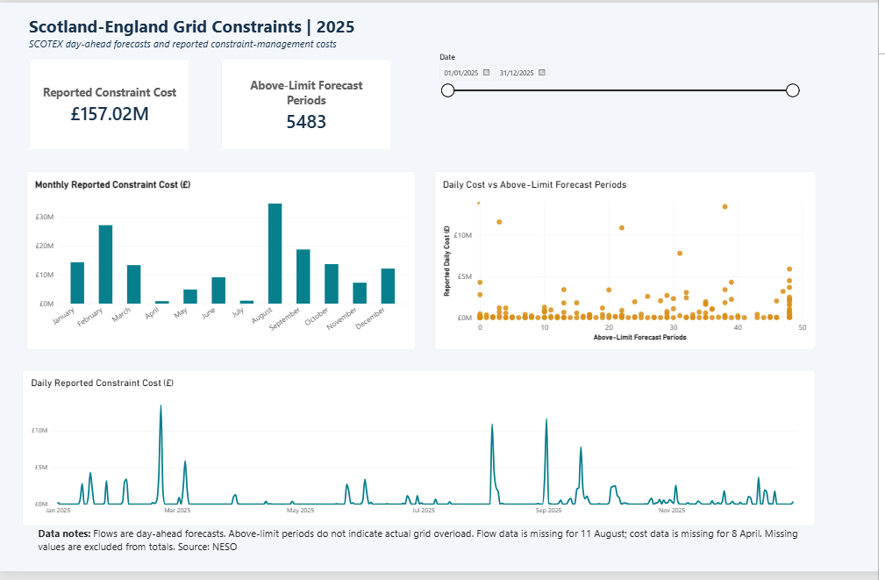

# Scotland–England Grid Constraints | 2025

Analysis of SCOTEX day-ahead electricity transfer forecasts and reported constraint-management costs during 2025, using Python, SQL and Power BI.

## Business question

How often was forecast electricity flow above the published SCOTEX transfer limit, and how did those periods compare with reported daily constraint-management costs?

## Dashboard

The dashboard includes reported cost, above-limit forecast periods, monthly and daily cost trends, and a comparison of daily cost with above-limit periods. A date slicer allows users to explore specific periods.

## Key findings

- Forecast flow exceeded the published limit in **5,483 of 17,472 available half-hourly records (31.4%)**.
- Reported SCOTEX costs totalled **£157.02 million across 364 reported dates**.
- **August** had the highest reported monthly cost, at **£34.64 million**.
- **21 February** had the highest reported daily cost: **£13.49 million**, with **38 above-limit forecast periods**.
- **31 August** recorded **£11.64 million** despite having only **3 above-limit forecast periods**. The number of above-limit periods alone does not explain daily cost.

These findings support reviewing expensive days individually rather than using forecast exceedance counts alone to assess cost.

## Data preparation and analysis

- Filtered the flow and cost datasets to SCOTEX and calendar year 2025.
- Combined January–March costs from the 2024–25 file with April–December costs from the 2025–26 file.
- Removed 48 exact duplicate flow records.
- Checked missing dates, null values and duplicate records.
- Calculated forecast flow minus the published limit and counted above-limit periods.
- Aggregated half-hourly records into daily and monthly summaries.
- Compared Python results with SQLite queries using filtering, grouping, a common table expression and a join.
- Exported a daily summary for the Power BI report.

## Tools

- **Python:** pandas and Matplotlib for preparation, analysis and visualisation.
- **SQL:** SQLite for querying data and cross-checking results.
- **Power BI:** Power Query and an interactive report.
- **Google Colab:** notebook development and execution.

## Data sources

The analysis uses three CSV files from the [NESO Data Portal](https://www.neso.energy/data-portal):

1. Day Ahead Constraint Flows and Limits:
   `day-ahead-constraints-limits-and-flow-output-v1.5.csv`
2. Outturn System Costs 2024–2025:
   `outturn-system-costs-2024-2025.csv`
3. Outturn System Costs 2025–2026:
   `outturn-system-costs-2025-2026.csv`

The original CSV files are not included in this repository. Download them from NESO and retain the filenames above. Later source revisions may produce different results.

## How to run

1. Download the notebook and the three source CSV files.
2. Create a folder named `data` in the working directory and place the CSVs inside it.
3. Run the notebook cells in order.

For Google Colab, create `/content/data` in the Files panel and upload the CSVs there. No Google Drive connection is required. Files uploaded to a Colab session are temporary.

The notebook exports `scotex_daily_dashboard_2025.csv` into the `data` folder.

To explore the Power BI report, download and open the `.pbix` file in Power BI Desktop. To refresh its data, update the CSV source path to your local copy of the exported daily summary.

## Limitations

- Flows are day-ahead forecasts, not measurements of actual electricity flow.
- Above-limit forecasts do not establish that the grid was actually overloaded.
- Flow data is missing for **11 August 2025**; cost data is missing for **8 April 2025**.
- Missing values were retained rather than replaced with zero. Totals exclude missing observations.
- The reported cost total is therefore not a complete annual total.
- This comparison does not identify the causes of individual costs or quantify the effects of specific management actions.

## Repository files

- `Scotland_England_Grid_Constraint_2025_GitHub.ipynb` — Python analysis and SQL queries.
- `Scotland_England_Grid_Constraints_2025.pbix` — Power BI report.
- `Dashboard.png` — dashboard preview.
